# Lab7Web_PHP - Praktikum 7: Pemrograman Server-Side dengan PHP

| | |
|---|---|
| **Nama** | Sairin bin Rubad |
| **NIM** | 312510134 |
| **Mata Kuliah** | Pemrograman Web |
| **Topik** | Pemrograman server-side dengan PHP |

---

## 1. Tujuan Praktikum

- Memahami perbedaan pemrosesan client-side dan server-side.
- Mengenali sintaks PHP dan menjalankan file PHP melalui server lokal.
- Menggunakan variabel, tipe data, operator, percabangan, perulangan, dan function.
- Menerima dan memproses data dari form HTML menggunakan metode GET dan POST.
- Melakukan validasi dan sanitasi input dasar sebelum data ditampilkan atau diproses.
- Membangun aplikasi sederhana yang menerima, memproses, dan menampilkan data pengguna.

## 2. Perangkat yang Digunakan

- Laptop/PC dengan web browser (Google Chrome)
- Visual Studio Code
- XAMPP (PHP + Apache)
- Git dan GitHub

## 3. Cara Menjalankan Server Lokal

1. Instal XAMPP, lalu buka **XAMPP Control Panel**.
2. Klik **Start** pada modul **Apache**.
3. Salin folder `Lab7Web_PHP` ke direktori `C:\xampp\htdocs\`.
4. Buka browser dan akses `http://localhost/Lab7Web_PHP/`.
5. Pilih latihan dari menu di halaman utama, atau akses langsung, misalnya `http://localhost/Lab7Web_PHP/latihan1.php`.

> File PHP **tidak boleh** dibuka dengan klik ganda (`file:///...`) karena kode PHP hanya diproses oleh web server.

## 4. Struktur File

```
Lab7Web_PHP/
├── README.md
├── style.css            # gaya tampilan bersama
├── index.php            # halaman utama (Latihan 1 + menu)
├── latihan1.php         # Latihan 1 - Menjalankan PHP
├── latihan2.php         # Latihan 2 - Variabel, operator, percabangan
├── latihan3.php         # Latihan 3 - Perulangan dan array
├── latihan4.php         # Latihan 4 - Function
├── latihan5.php         # Latihan 5 - Form GET
├── latihan6.php         # Latihan 6 - Form POST
├── latihan7.php         # Latihan 7 - Pengolahan data sederhana
├── miniproject.php      # Mini Project - Formulir Data Mahasiswa
├── eksperimen.php       # Eksperimen Mandiri (5 eksperimen)
└── screenshots/         # Screenshot hasil setiap latihan
```

---

## 5. Hasil Praktikum

### Halaman Utama (`index.php`)

Menampilkan hasil Latihan 1 dan menu menuju seluruh latihan.

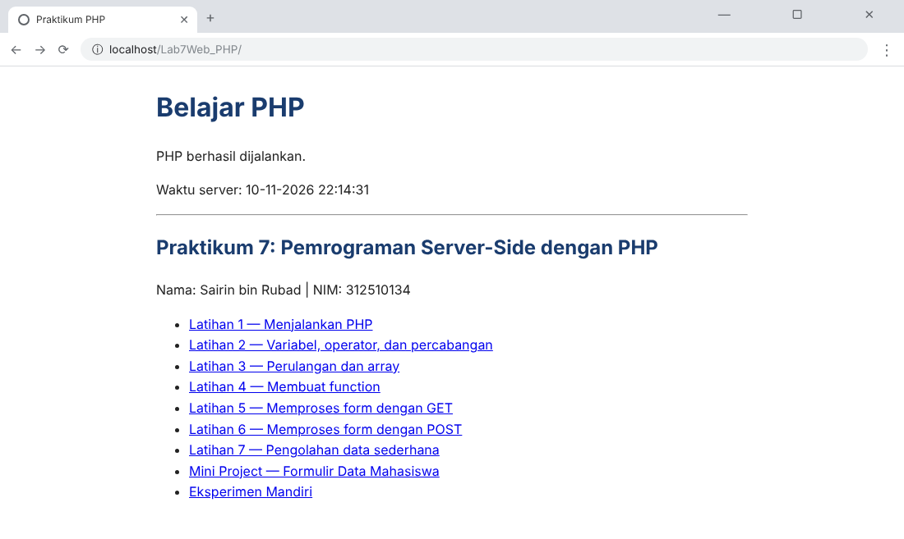

### Latihan 1 - Menjalankan PHP (`latihan1.php`)

Kode PHP dijalankan oleh server. Browser hanya menerima hasil HTML, sehingga kode PHP tidak tampil sebagai teks, dan waktu server tampil sesuai fungsi `date()`.

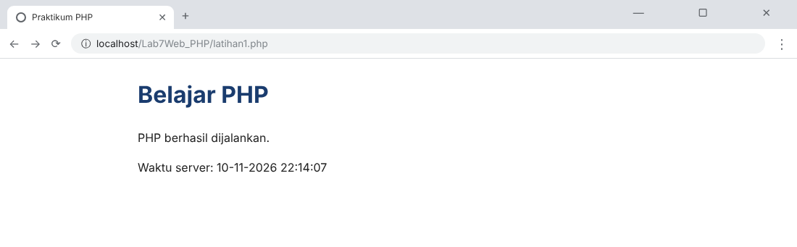

### Latihan 2 - Variabel, Operator, dan Percabangan (`latihan2.php`)

Nilai akhir = (Tugas x 30%) + (UTS x 30%) + (UAS x 40%). Untuk Siti (85, 78, 90) hasilnya **84,90** dengan predikat **B**. Tabel di bawahnya menguji beberapa kombinasi nilai sehingga keempat predikat (A, B, C, D) teruji.

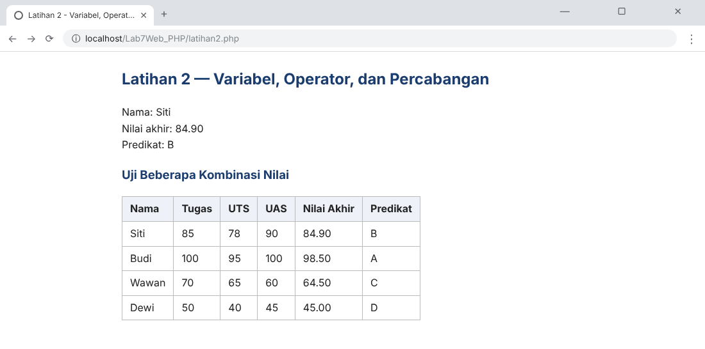

### Latihan 3 - Perulangan dan Array (`latihan3.php`)

Array berisi 7 nama mahasiswa (4 dari modul + 3 tambahan: Eka, Fajar, Gita) ditampilkan dengan `foreach`.

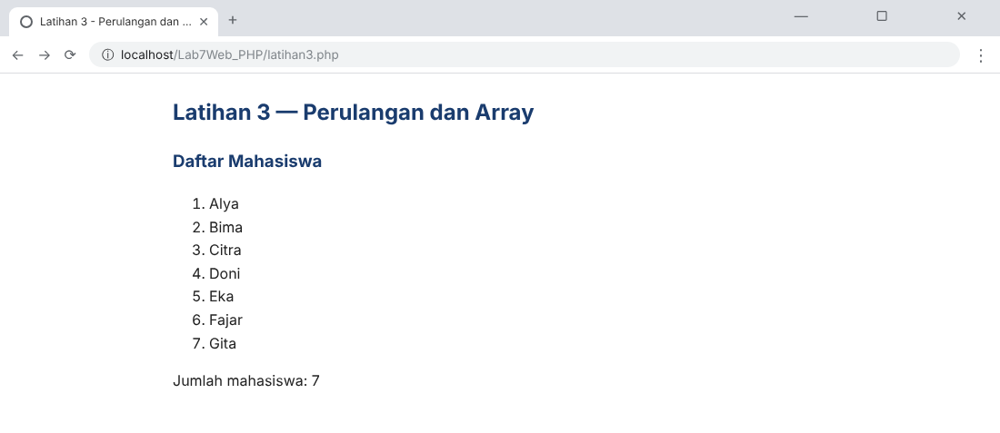

### Latihan 4 - Membuat Function (`latihan4.php`)

Function `hitungDiskon()` dari modul, ditambah dua function baru: `hitungLuasPersegiPanjang()` dan `tentukanKelulusan()`.

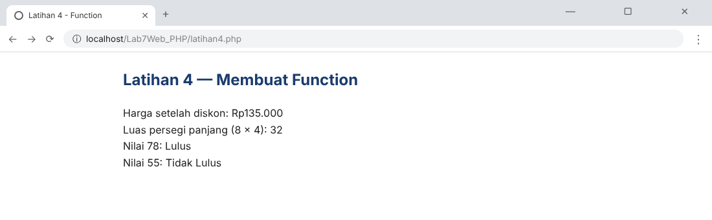

### Latihan 5 - Memproses Form dengan GET (`latihan5.php`)

Form dikirim dengan metode GET sehingga data muncul pada URL (`?kata=Pemrograman+Web`).

Sebelum form dikirim:

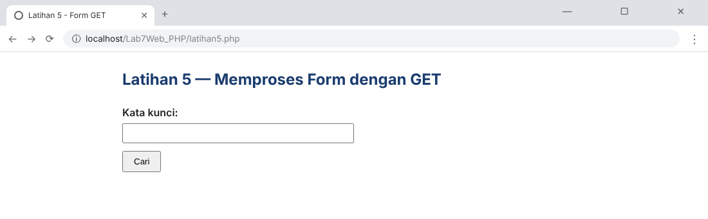

Setelah form dikirim (perhatikan perubahan URL):

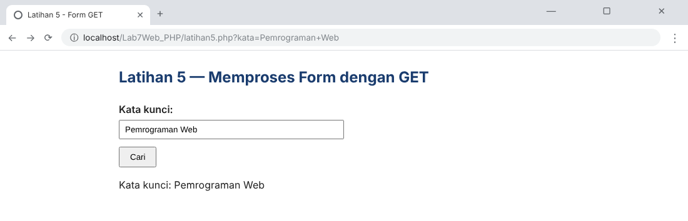

### Latihan 6 - Memproses Form dengan POST (`latihan6.php`)

**Data lengkap (valid):**

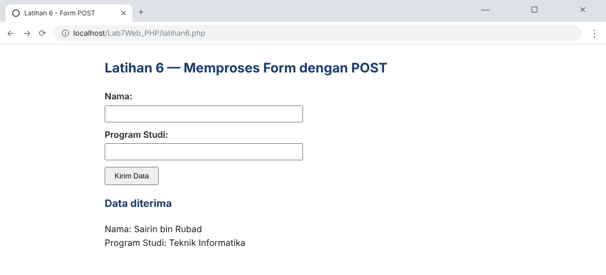

**Input kosong (hanya spasi):** ditolak oleh validasi server karena `trim()` menghasilkan string kosong.

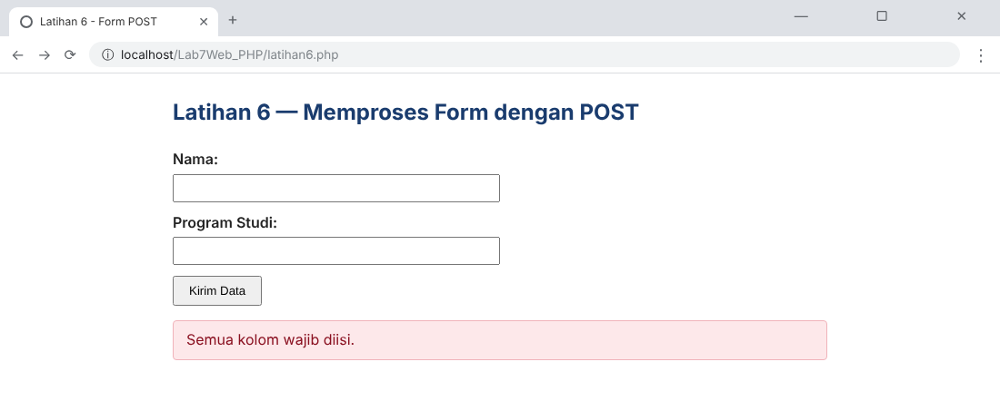

**Input berisi tag HTML dan tanda kutip:** ditampilkan sebagai teks biasa berkat `htmlspecialchars()`, sehingga script tidak dieksekusi.

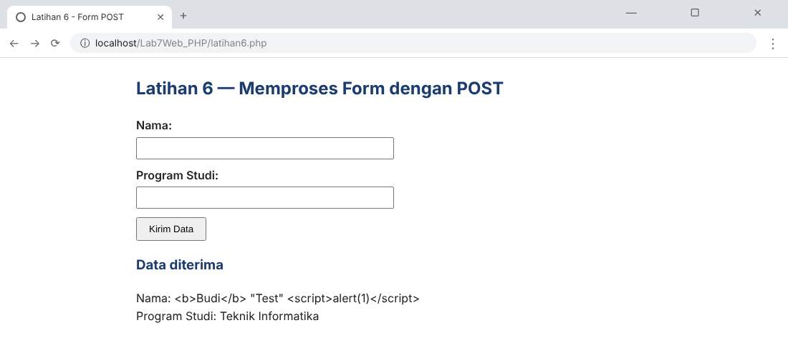

### Latihan 7 - Pengolahan Data Sederhana (`latihan7.php`)

**Data valid** (Pensil, harga 2500,50, jumlah 4 -> subtotal Rp10.002):

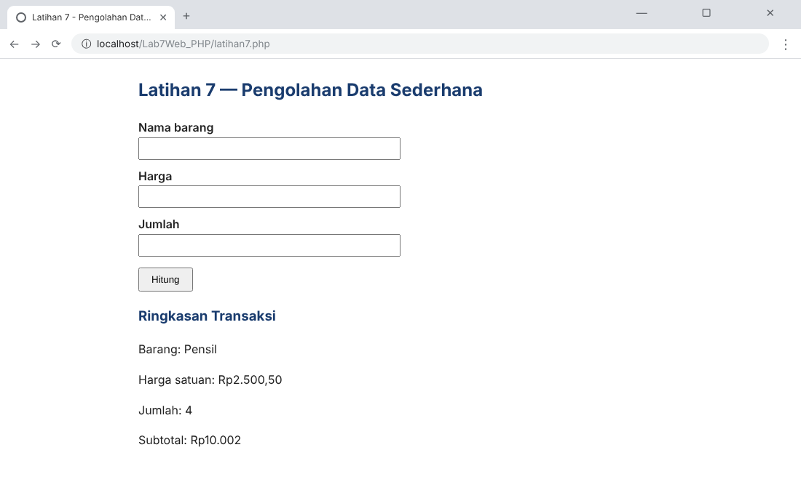

**Data tidak valid** (nama barang kosong):

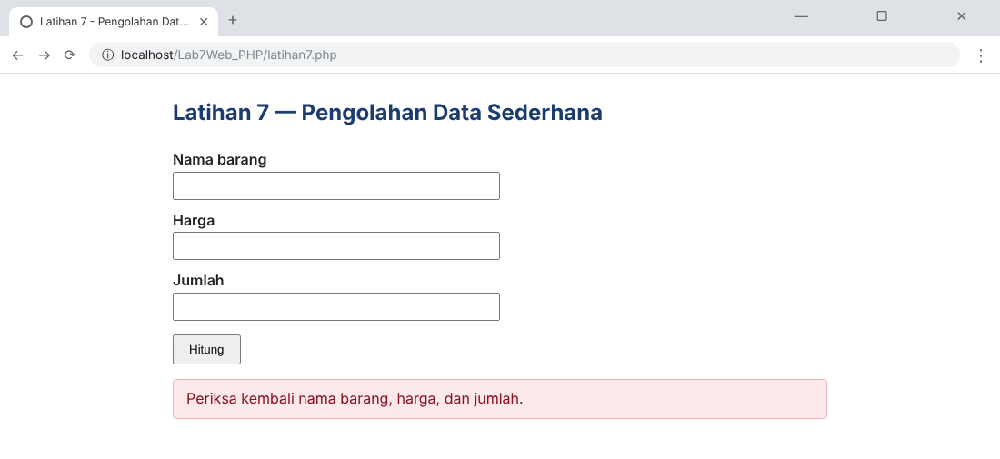

### Mini Project - Aplikasi Formulir Data Mahasiswa (`miniproject.php`)

Form berisi nama, NIM, program studi, semester, dan email, dikirim dengan POST. Bagian pemrosesan data dipisahkan dari bagian tampilan HTML. Atribut `novalidate` dipakai pada form agar validasi server-side PHP dapat diuji langsung tanpa dihalangi validasi browser.

**Input valid:**

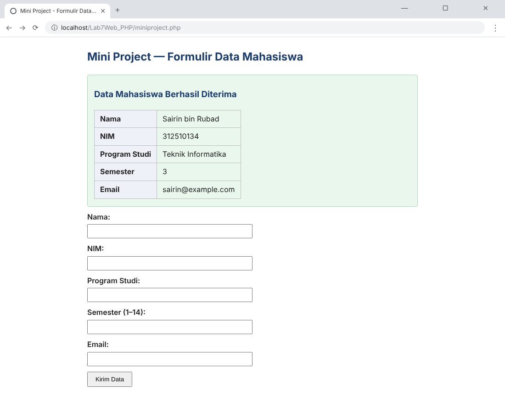

**Input tidak valid** (nama kosong, email tidak valid, semester 20): seluruh pesan kesalahan ditampilkan dan isian form dipertahankan.

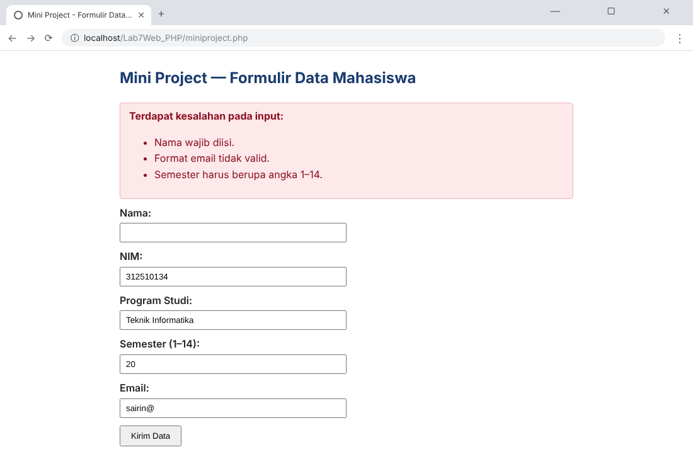

### Eksperimen Mandiri (`eksperimen.php`)

1. **Rata-rata tiga komponen nilai** - (85 + 78 + 90) / 3 = 84,33.
2. **Pencarian nama dengan GET** - kata kunci `it` menghasilkan Citra dan Gita dari array data.
3. **Function format Rupiah** - `formatRupiah()` mengubah angka menjadi format `Rp1.250.000`.
4. **Validasi NIM** - hanya angka dan tepat 9 digit.
5. **Tombol Reset** - dijelaskan perbedaannya dengan pemrosesan ulang di server.

Hasil eksperimen 1-3 (pencarian `?cari=it`):

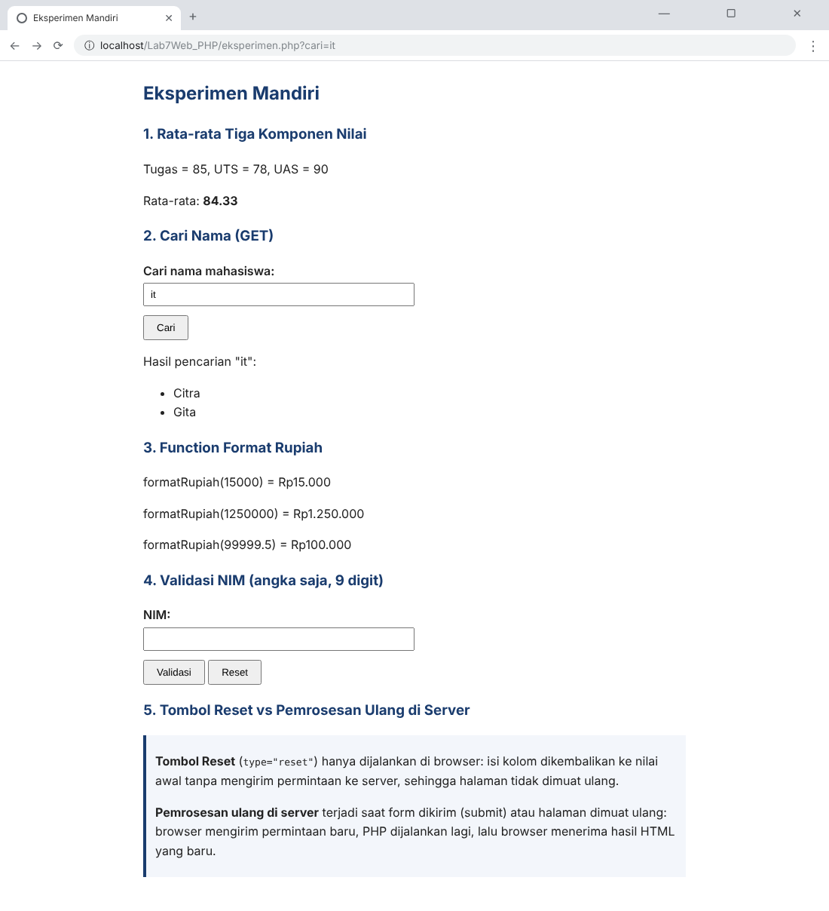

Validasi NIM tidak valid (mengandung huruf):

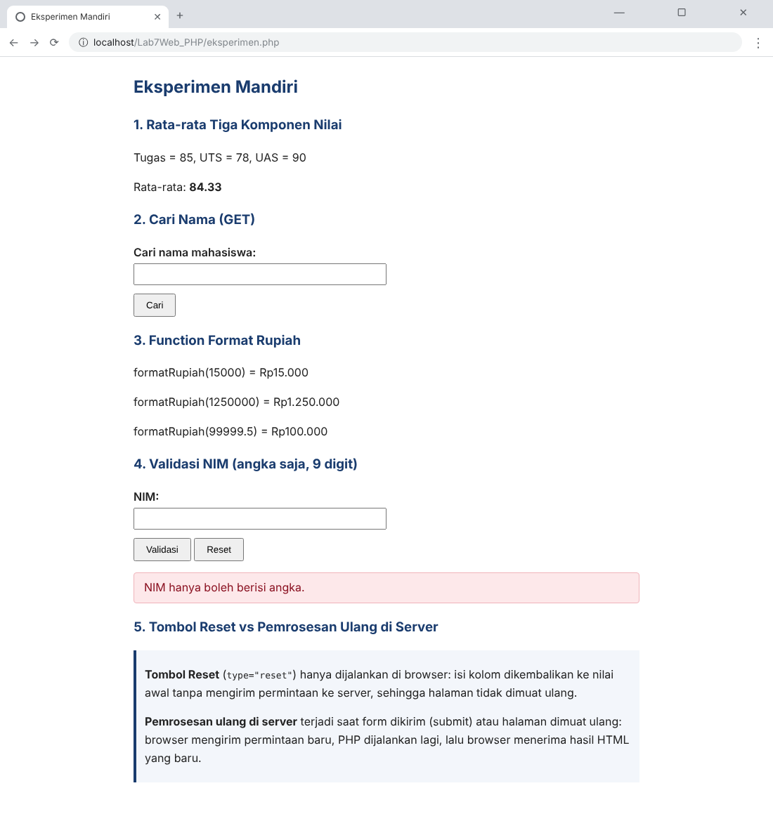

Validasi NIM valid (`312510134`):

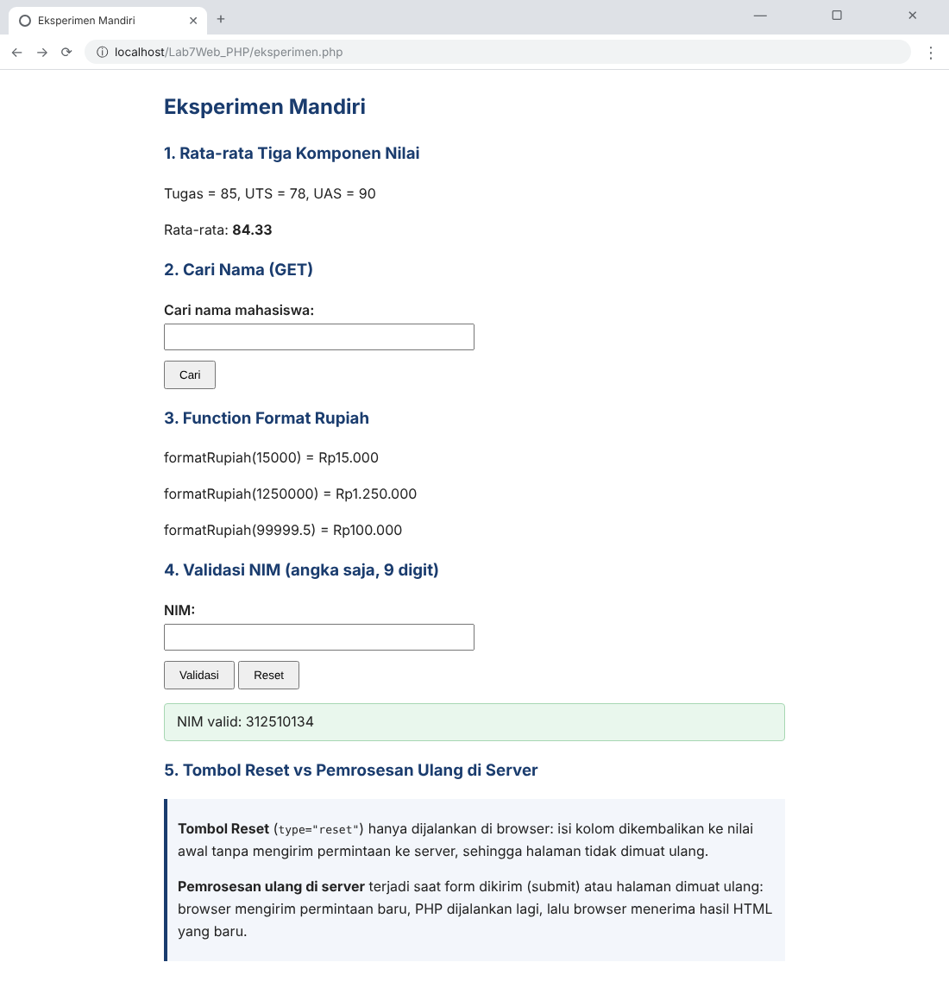

---

## 6. Kasus Uji Input

### Input valid

| No | Halaman | Input | Hasil |
|---|---|---|---|
| 1 | Latihan 6 | Nama `Sairin bin Rubad`, Prodi `Teknik Informatika` | Data diterima dan ditampilkan |
| 2 | Latihan 7 | Barang `Pensil`, harga `2500.50`, jumlah `4` | Subtotal Rp10.002 |
| 3 | Mini Project | Semua kolom terisi, semester `3`, email `sairin@example.com` | Ringkasan data mahasiswa ditampilkan |

### Input tidak valid

| No | Halaman | Input | Hasil |
|---|---|---|---|
| 1 | Latihan 6 | Nama dan Prodi hanya spasi | Muncul pesan "Semua kolom wajib diisi." |
| 2 | Latihan 7 | Nama barang kosong | Muncul pesan "Periksa kembali nama barang, harga, dan jumlah." |
| 3 | Mini Project | Nama kosong, email `sairin@`, semester `20` | Tiga pesan kesalahan ditampilkan |
| 4 | Eksperimen 4 | NIM mengandung huruf | Muncul pesan "NIM hanya boleh berisi angka." |

> Catatan: pada Latihan 7, jumlah `0` atau negatif akan dicegah lebih dulu oleh atribut `min="1"` di browser. Validasi PHP (`ctype_digit()` dan `(int)$jumlahInput < 1`) tetap menolaknya jika data dikirim tanpa melalui form, misalnya lewat alat pengembang atau `curl`.

---

## 7. Jawaban Pertanyaan Evaluasi

**1. Apa perbedaan pemrosesan client-side dan server-side?**
Client-side dijalankan di browser pengguna (HTML, CSS, JavaScript). Server-side dijalankan di server (misalnya PHP): server menerima permintaan, memproses data, lalu mengirim hasilnya (biasanya HTML) ke browser.

**2. Mengapa file PHP harus dijalankan melalui web server?**
Kode PHP harus diinterpretasikan oleh PHP engine yang berjalan bersama web server (Apache/Nginx). Jika dibuka dengan klik ganda, browser hanya menampilkan teks kode mentah tanpa menjalankannya.

**3. Apa fungsi tanda `$` pada variabel PHP?**
Tanda `$` menandai bahwa sebuah nama adalah variabel, misalnya `$nama`. Nama variabel bersifat case-sensitive.

**4. Apa perbedaan metode GET dan POST?**
GET mengirim data lewat parameter URL, terlihat dan cocok untuk permintaan yang tidak mengubah data (misalnya pencarian). POST mengirim data pada body permintaan, lazim untuk pengiriman form. POST bukan enkripsi, sehingga tetap perlu HTTPS.

**5. Mengapa input pengguna perlu divalidasi di sisi server?**
Validasi di browser (misalnya `required`) mudah dilewati. Server harus memeriksa ulang agar data kosong, tidak sesuai format, atau berbahaya tidak diproses.

**6. Apa fungsi `htmlspecialchars()` ketika menampilkan data dari form?**
Mengubah karakter khusus HTML (`<`, `>`, `"`, `&`, `'`) menjadi entitas, sehingga input ditampilkan sebagai teks biasa dan tidak dieksekusi sebagai HTML/script (mengurangi risiko XSS).

**7. Apa manfaat penggunaan function dalam program PHP?**
Kode dapat dipakai ulang, program lebih rapi dan mudah dibaca, perbaikan cukup dilakukan di satu tempat, dan pengujian lebih mudah.

---

## 8. Kesimpulan

Praktikum ini memperlihatkan bahwa PHP diproses di sisi server dan browser hanya menerima hasil HTML-nya. Variabel, percabangan, perulangan, array, dan function dapat dipakai untuk mengolah data. Form dapat diproses dengan GET maupun POST, dan setiap input dari pengguna harus divalidasi di server serta diamankan dengan `htmlspecialchars()` sebelum ditampilkan.
